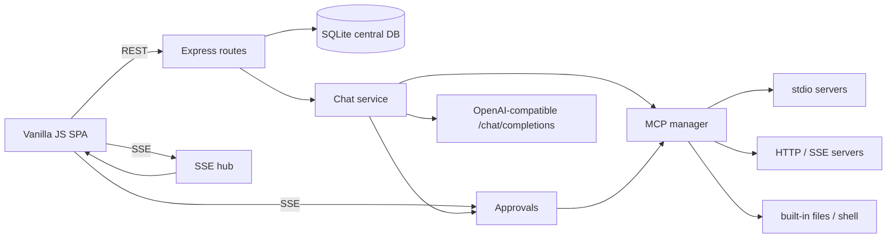

# RiSriGPT

A self-hosted chat application that talks to **any OpenAI-compatible server**
(LM Studio, Ollama, llama.cpp server, vLLM, LocalAI, OpenAI, …). Conversations,
personas, MCP tool servers and settings all live in one **central SQLite database**.

- 🖥 Node.js + Express backend, dependency-light vanilla JS frontend
- 🗄 Central SQLite database (`data/app.db`) — conversations, messages, tool traffic, settings
- 🔌 **MCP tools** — add Model Context Protocol servers (stdio / streamable HTTP / SSE) from Settings
- 📦 **Built-in MCP servers** — `files` (file management) and `shell` (run commands), no install needed
- ✅ **Per-chat tool policy** — every conversation has its own working folder, approval mode,
  access scope and on/off switch for each tool set, all behind the **+** button in the message box
- 🎭 **Multiple system prompts** — named personas, one default, switchable per conversation
- 💬 **Conversation mode** — persistent multi-turn chats with streaming, regenerate, edit-and-resend
- 🛠 Full tool-calling loop: the model calls MCP tools, results are fed back until it answers
- 📡 Server-Sent Events streaming, **attachments** (images go to vision servers, files land in the chat folder)
- 📱 Responsive: sidebar drawer and full-screen dialogs on phones
- 🧠 Reasoning models supported: chain-of-thought (`delta.reasoning_content`) shows as a
  live "Thinking…" preview and is kept out of the saved answer

## Quick start

```bash
npm install
npm start
```

Open <http://127.0.0.1:3000>, click **⚙ Settings**, set the **Base URL** of your
OpenAI-compatible server (e.g. `http://localhost:1234/v1` for LM Studio or
`http://localhost:11434/v1` for Ollama), press **Fetch models**, pick one, **Save**.

```bash
npm run dev     # auto-restart on server file changes
PORT=8080 npm start
HOST=0.0.0.0 npm start   # expose on the LAN (no auth built in — use a firewall)
DB_PATH=/some/where/app.db npm start
```

Requires Node.js 22+ (global `fetch`, and the `better-sqlite3` prebuilds).

### Start everything at boot (Windows)

| File | What it does |
| --- | --- |
| `start-model.bat` | Runs `C:\AI\gufo-build\gufo.exe serve` (qwen3.8-flash-next-unsloth-q4-k-xl) — skipped if something already listens on 8080. |
| `start-server.bat` | Starts the chat app on **`0.0.0.0:3000`** (LAN visible) **as administrator** (self-elevates with one UAC prompt; skipped when already elevated, e.g. from the boot task), logging to `logs\server.log`. Does nothing if 3000 is already up. |
| `start-all.bat` | The full order: model → wait until `GET /v1/models` answers (up to 30 min while the weights load) → chat app. |
| `start-all-hidden.vbs` | Same, with no window at all. This is what the boot task runs. |
| `stop-server.bat` | Stops whatever is listening on port 3000. |
| `install-autostart.ps1` | One-shot setup: firewall rules, LAN binding, Scheduled Task. |

```powershell
.\install-autostart.ps1              # one UAC prompt, then:
                                     #  - firewall: allow inbound TCP 3000 + 8080
                                     #  - model config: "host": "0.0.0.0" (backs up the .json)
                                     #  - Scheduled Task "RiSriGPT" at every boot, before logon
.\install-autostart.ps1 -Remove      # removes the task and the firewall rules
.\install-autostart.ps1 -LocalOnly   # autostart only, keep both servers on 127.0.0.1
```

The task is registered with an **AtStartup** trigger and `S4U` logon, so it runs
when the machine boots, whether or not anyone logs in (`start-all.bat` waits 20 s
first so the network has settled). Watch it with
`Get-ScheduledTaskInfo "RiSriGPT"` and start it by hand with
`Start-ScheduledTask -TaskName "RiSriGPT"`.

> The **model** server only re-reads `"host": "0.0.0.0"` when it is next launched, so a
> model that was already running keeps listening on `127.0.0.1:8080` until you restart it.
> Nothing breaks — the chat app talks to it locally — but other devices cannot reach the
> raw `/v1` API until then. Check with
> `Get-NetTCPConnection -LocalPort 8080 -State Listen`.

Then open the app from any device on the network: `http://<this PC>:3000`
(the installer prints the addresses; `http://127.0.0.1:3000` still works locally).
Find the current address with `Get-NetIPAddress -AddressFamily IPv4` — it changes when
the router hands out a new lease, and virtual adapters (`vEthernet`, Tailscale,
VirtualBox) also appear in that list.

> **If a phone/laptop on the Wi-Fi cannot connect** but `http://<ip>:3000` works on the
> PC itself, Windows has probably classified that connection as a **Public** network
> (`Get-NetConnectionProfile`). The rules are installed for `-Profile Any`, so re-run
> `.\install-autostart.ps1` once to widen any older rule, or move the connection to the
> Private profile: `Set-NetConnectionProfile -InterfaceAlias "<adapter>" -NetworkCategory Private`.

> ⚠ **The app has its own accounts.** The first person to open it creates the
> administrator account; after that, new sign-ups are **off** unless an admin enables
> *Settings → Accounts → Allow new sign-ups* (or creates accounts directly in the user
> menu). Conversations, remembered approvals and settings access are per user, and only
> admins can change global settings, manage MCP servers, browse the server's disk or
> create accounts. Keep the port on a trusted/private network anyway, or restrict the
> two firewall rules to your subnet:
> `Set-NetFirewallRule -DisplayGroup "RiSriGPT" -RemoteAddress 192.168.0.0/24`.
> The model server also gains a DNS-rebinding host check once it listens beyond
> loopback; if a client is refused, add its name via `allowed_hosts` in
> `strata-unsloth-ud-iq4_xs.json`.

## Features

### Interface

Deliberately plain, ChatGPT-shaped layout: dark sidebar with the conversation list,
a centred reading column, and one rounded composer at the bottom. No avatars, no
cards, no chrome — message actions (copy / regenerate / edit / delete) only appear
when you hover a reply.

- **Everything per-chat lives in the composer's + menu**: attach photos and files,
  the chat's working folder (**📂** to browse the server's disk — admins only), **🗂 Files**
  (file manager), approval mode, file and shell on/off + access scope, MCP tools on/off,
  and the persona picker with **＋** to write a new one. The folder badge under the box
  shows the folder's name; hover it for the full path.
- **Header** keeps only what changes every now and then: the editable chat title,
  the model dropdown, and **⤓ Export** (Markdown download).
- **Themes** — dark (default), light, or follow the OS. Switch it in the user menu
  or with the command palette; the choice is stored in `localStorage` and applied
  before first paint, so there is no flash.
- **Command palette** — `Ctrl/Cmd+K` opens a searchable list of actions (new chat,
  settings, personas, MCP, theme, compact, export, sign out) and every conversation.
  `↑`/`↓` move, `Enter` runs, `Esc` closes.
- **Continue** — the last assistant reply gets a *continue* action, which asks the
  model to pick up exactly where it stopped without adding a visible user message
  (useful after **Stop** or a `max_tokens` cut-off).
- **Attachments** — pick files, drop them on the composer, or `Ctrl+V` an image (works
  for screenshots and images copied from apps, not just files copied in Explorer). They
  show as removable chips above the composer before you send (see *Attachments* below).
- **Mobile responsive** — below 780 px the sidebar becomes an off-canvas drawer
  (hamburger + tap-outside-to-close), dialogs go full-screen, and the **+** menu fits
  the viewport. The same page works from a phone on your LAN.
- **Scales up too** — the reading column, sidebar and type grow with the viewport
  (760 → 820 → 900 → 940 px at 1400 / 1750 / 2200 px wide), and the header, messages,
  composer and **+** menu all share the same centred column, so a 1440p or 4K monitor
  does not leave a narrow strip stranded on the left.

### Attachments

Anything you attach is processed when you press send:

- The **first image** is also sent to the model as `image_url` (base64 data URL, or the
  URL itself if you used *Attach image by URL*), so vision-capable servers can see it.
- **Non-image files** are saved into the conversation's working folder through the same
  policy-checked endpoint the model's file tools use, and the message the model receives
  ends with the absolute paths — so it can open them with `files__read_file`, run them
  with `run_command`, and so on. A *Restricted to one folder* conversation can only ever
  receive files inside its own folder.
- **Images are not written to disk**; they are only sent to the model, so the chat folder
  does not slowly fill with screenshots.

### Accounts

The first visit creates the administrator account (and claims any conversations that
predate accounts). After that:

- **Sign-ups are closed by default.** An admin can open them in
  *Settings → Accounts → Allow new sign-ups*, or create accounts one by one from the user
  menu → **Manage users** (with an admin/ordinary role switch).
- Every account has its own conversations, remembered tool approvals and password.
  Users can change their own password from the user menu.
- Global settings, the MCP editor, the server folder browser and direct MCP test calls
  are **admin only**; ordinary users get a read-only Settings dialog and can still use
  all per-chat tools, their files and their own approvals.
- Login and registration are rate limited (10 attempts per IP per 15 minutes), and
  passwords must be at least 8 characters.

### AI server (OpenAI compatible)

Settings → *AI server*. Base URL, API key, default model, temperature, max tokens.
The `/v1` suffix is appended automatically when missing, and a pasted
`.../chat/completions` URL is trimmed back. **Test connection** pings `/models`.
Each conversation can override the model from the header dropdown.

### MCP tools

**Settings → MCP servers** (the 🔌 MCP button opens Settings scrolled straight to it).
Add as many servers as you like — they all connect at the same time. Each one has:

| Field | Meaning |
| --- | --- |
| Name | Tool namespace: tools appear as `name__tool` |
| Transport | `stdio` (local command), `HTTP` (streamable), `SSE` (legacy) |
| Command / Arguments | For `stdio`: executable + JSON array of arguments |
| URL / Headers | For `HTTP` / `SSE`: endpoint and optional headers |
| Environment | JSON object merged over `process.env` for `stdio` servers |

Enabled servers connect at startup and whenever you save. **Save & connect** only touches
that one server, so you can add several in a row; each entry then has **reconnect**,
**edit** and **delete** (or **switch off** for the built-ins) plus its own approval
dropdown. The **Tools** switch in the header decides whether the connected tools are
offered to the model. Tool calls, arguments and results are shown inline and stored in
the database, so later turns keep the full context.

A demo server ships with the repo (`test/mock-mcp-server.js`, tools `echo` and
`get_weather`). Example: an official filesystem server looks like

```
transport: stdio
name:      filesystem
command:   npx
args:      ["-y", "@modelcontextprotocol/server-filesystem", "C:\\tmp"]
```

### Built-in tools: file management and shell

Two MCP servers ship inside the app, so the model can work on your machine without
you installing anything. They are real MCP servers (in-process, linked with the SDK's
in-memory transport), so they appear under **Settings → MCP servers** with a `built-in` badge,
their tools are namespaced like everyone else's, and you can **switch them off** there.
They cannot be deleted or reconfigured — only enabled/disabled.

**`files`** — `list_directory`, `read_file`, `write_file`, `create_directory`,
`delete_path`, `move_path`, `copy_path`, `file_info`, `search_files`, `search_text`

**`shell`** — `run_command` (waits, returns exit code + stdout + stderr),
`start_command` (background job), `job_output`, `list_jobs`, `kill_process`,
`list_processes`

**There is no global tool policy.** Everything below lives in the **+** menu of the message
box and is stored **on that conversation**, so one chat can be a
sandboxed helper in `~/Documents/notes` while another runs freely on the whole disk.
A brand-new conversation starts with the defaults: working folder = your user home
folder, *Ask me first*, *Restricted to one folder*, both tool sets on. Change any of
them at any time, even mid-conversation — the next message picks it up.

**Approval**

| Mode | Behaviour |
| --- | --- |
| **Ask me first** (default) | Anything that changes something pauses and shows you the exact command or file + content. Read-only tools (listing, reading, searching) never interrupt you. |
| **Allow everything automatically** | Tools run immediately, no prompts. |

When a prompt appears you get **Allow**, **Allow for this chat**, **Always allow**
and **Deny**. *Always allow* is remembered across restarts (clear it with
**Forget remembered approvals**); *Allow for this chat* lasts until you close the app.
Grants are stored per account, so one user's *Always allow* never applies to another
user's chats. Denying never breaks the turn — the model is told you declined and answers
another way. Prompts stay pending if you switch conversation or reload the page, so you
can still answer them, and they are only delivered to the account that made the call.

**Access scope** (independent of approval, and per feature)

| Mode | Behaviour |
| --- | --- |
| **Restricted to one folder** (default) | File tools may only touch the folder you name; paths that escape it (including `..\` tricks and symlinks) are refused. Shell commands may only *start* inside the folder you name. |
| **Full access** | No path restrictions. |

> ⚠ **Restricting the shell is a guardrail, not a sandbox.** It pins the starting
> directory, but a command can still `cd` somewhere else. **Approval mode is the real
> protection** for shell access — keep it on *Ask me first* unless you trust the model
> and the server you are talking to.

Each MCP server also has an **approval** dropdown (`auto` / `always ask` / `never ask`)
that overrides the conversation's approval mode for that server. Built-in servers default
to `auto` (guard anything not marked read-only); servers you add default to `auto` too,
which means *no* prompts — set one to `always ask` if you want to vet its tools.

**Tool sets** — the **Files** and **Shell** switches turn each built-in set on or off for
this conversation. When a set is off its tools are not even offered to the model, so it
cannot try to use them. The **⏱ shell timeout** is the one setting that stays global
(**Settings → Built-in tools**), along with **Forget remembered approvals**.

**Choosing the working folder** — the **📂** button in the **+** menu opens a folder
browser of *the machine the server runs on* (drives, parent folder, home shortcut), where
you can create a new folder on the spot and apply it to this conversation. Useful when the
app is open on a laptop but the folder lives on the desktop box. Because it exposes the
whole host disk, the browser is **admin only**; other users can still type a path into the
folder field of the **+** menu (their own chat's tools remain confined by its access scope).

### Chat file manager

The **🗂 Files** button in the **+** menu opens a file manager for this conversation's working folder:
browse, preview text files, download, upload, new folder, rename and delete.

It is **not** a general-purpose file browser — every path goes through the same policy the
model's file tools use. A conversation in *Restricted to one folder* mode cannot see
anything outside its working folder (`?path=..` is refused with `403`), while one in
*Full access* mode can browse the whole disk. Deleting is two-step (`🗑` → `sure?`) so
nothing disappears on a stray click.

### Thinking, speed and produced files

Every assistant reply keeps what it cost and what it touched, and it is stored in the
database, not just shown once:

- **🧠 Thinking** — the model's chain of thought (`reasoning_content`, or `reasoning` if
  that is what your server sends) is saved with the message and rendered as a collapsed
  block. It is never thrown away, and regenerating keeps the new round's thinking.
- **Stats line** — `⏱ 26s · ⚡ 15.2 tok/s gen · 📥 823 tok/s prompt · 7517 → 220 tok`.
  Generation and prompt speeds come from the server's own `timings` block when it sends
  one (llama.cpp-style servers do); otherwise only the wall-clock duration and token
  counts from `usage` are shown. While a reply streams you get a live ⏱ + tok/s counter.
- **File chips** — when a tool writes a file (`write_file`, `create_directory`,
  `copy_path`, `move_path`), the reply gets a `📄 name 94 B ⬇` chip that downloads it
  straight from the chat. Files created by shell commands are not tracked — only the
  built-in file tools report what they produced.

### System prompts (personas)

Settings → *Prompts*. Create as many personas as you like, mark one **default**
(applied to new conversations) and switch persona per conversation. The persona
dropdown and a **＋** button (create a prompt and apply it here immediately) also sit
in the **+** menu.

### Conversations

Sidebar lists every conversation with search, rename, delete and auto-titling from
the first message. While a reply streams you can press **■** (or `Esc`) to stop.
Per message: **copy**, **regenerate** (re-answer the last turn), **edit** a user
message (truncates and resends), **delete**. `Ctrl/Cmd+N` starts a new chat. The
**+** menu above the message box holds this conversation's working folder (plus **📂** to pick
one from the server's disk), approval mode, file/shell access scope, the Files and Shell
switches, the persona picker, and **🗂 Files** to manage the conversation's folder.

## How a chat turn works

1. The browser `POST`s to `/api/chat` and reads the SSE stream.
2. The server loads the conversation transcript from SQLite, applies that conversation's
   tool policy for the whole turn, prepends the selected system prompt, and calls
   `<apiUrl>/chat/completions` with the MCP tool list (tool sets switched off for this
   conversation are left out).
3. If the model returns `tool_calls`, each one is namespaced (`server__tool`). Anything
   the conversation's policy says needs approval waits for your decision first. The call
   is then executed by the MCP manager, stored in `messages`, and fed back. This repeats
   until the model answers — *Max tool rounds* caps it when set to a number, and is
   unlimited when the field is blank (the default).
4. Text deltas are streamed to the UI as they arrive. Reasoning deltas, the files the
   tools produced, and the usage/timings the server reported are stored with the
   assistant message, and the final message is persisted.

## Architecture



## Database

Single file, `data/app.db` (override with `DB_PATH`). Tables: `settings`,
`system_prompts`, `conversations`, `messages` (including `tool_calls` / `tool_call_id`
rows, plus `reasoning`, `files` and the `duration_ms` / `prompt_tokens` /
`completion_tokens` / `pp_tok_s` / `tg_tok_s` counters), `mcp_servers` (also holding
`builtin_key` and a per-server `approval` policy). Each `conversations` row carries its
own tool policy: `workdir`, `approval_mode`, `file_access`, `shell_access`,
`files_enabled`, `shell_enabled`. Back up by copying the file.

## API

| Method | Path | Purpose |
| --- | --- | --- |
| `GET` | `/api/health` | status + database path |
| `GET` | `/api/auth/status` | session state, `needs_setup`, `open_registration` |
| `POST` | `/api/auth/register` | create an account (the first account becomes admin) |
| `POST` | `/api/auth/login` · `/api/auth/logout` | sign in / sign out |
| `GET` | `/api/auth/me` · `POST /api/auth/change-password` | current user / change own password |
| `GET`/`POST`/`PATCH`/`DELETE` | `/api/auth/users…` | admin user management (list/create/role/delete) |
| `GET` | `/api/settings` | read settings (API key masked) |
| `GET` | `/api/settings/health` | read-only ping of the configured server (any user) |
| `PUT` | `/api/settings` | **admin:** update settings, incl. `allow_registration` |
| `POST` | `/api/settings/test` | **admin:** ping the configured server |
| `GET` | `/api/settings/models` | list models from the server |
| `GET`/`POST` | `/api/prompts` | list / create personas |
| `PUT`/`DELETE` | `/api/prompts/:id` | update / delete; `POST /:id/default` makes it default |
| `GET`/`POST` | `/api/conversations` | list / create (POST accepts the policy fields below) |
| `GET`/`PATCH`/`DELETE` | `/api/conversations/:id` | read with messages / rename, change persona, model **or tool policy** / delete |
| `POST` | `/api/conversations/:id/messages` | append a message |
| `DELETE` | `/api/conversations/:id/messages/:messageId` | delete a message |
| `POST` | `/api/conversations/:id/truncate-after` | drop messages from `message_id` onwards |
| `GET` | `/api/conversations/:id/export?format=md\|json` | download the transcript (ownership-checked) |
| `POST` | `/api/chat` | start a turn (JSON ack; `409` if one is already running) |
| `GET` | `/api/chat/stream?conversation_id=&last_event_id=` | **SSE stream**: `delta`, `reasoning`, `tool_generating`, `tool_call`, `tool_result`, `tool_denied`, `tool_cancelled`, `tool_unavailable`, `file_created`, `notice`, `stats`, `done`, `error`, `resync` |
| `GET` | `/api/chat/running` | conversations generating right now |
| `POST` | `/api/chat/stop` · `/api/chat/stop-tool` | stop the turn / cancel one tool call |
| `POST` | `/api/chat/compact` | compact older turns into the summary now |
| `GET` | `/api/fs/browse?path=` | **admin:** browse the server's folders; `POST /api/fs/mkdir` creates one |
| `GET` | `/api/conversations/:id/fs?path=` | list this chat's folder · `/stat`, `/raw` (inline or `?download=1`), `POST /mkdir`, `/write`, `/upload`, `/rename`, `/delete` |
| `GET` | `/api/mcp` | servers with live status and discovered tools (secrets only for admins) |
| `POST`/`PUT`/`DELETE` | `/api/mcp…` | **admin:** add/update/delete servers; `POST /:id/connect`, `/:id/disconnect`, `/:id/tools`, `/:id/call` |
| `GET` | `/api/settings/tool-policy` | defaults a new conversation starts with |
| `GET` | `/api/approvals` | this user's pending decisions + remembered allowances |
| `GET` | `/api/approvals/stream` | **SSE stream**: this user's `approval_request`, `approval_resolved` |
| `POST` | `/api/approvals/:id` | answer one: `{ "allowed": true, "scope": "once" \| "conversation" \| "always" }` |
| `POST` | `/api/approvals/grants/clear` | forget this user's remembered allowances |

`POST /api/chat` body:

```json
{
  "conversation_id": 1,
  "content": "hello",
  "image_url": "https://…",
  "regenerate": false,
  "continue": false,
  "use_tools": true,
  "extra_system": "answer in one sentence",
  "model": "optional override",
  "temperature": 0.7,
  "max_tokens": 512
}
```

`POST /api/chat` stores the user message and starts the turn; it returns `409` while
another turn is still running for that conversation (open the stream to watch it).
`GET /api/chat/stream` emits `delta` when the model produces text and `approval_request`
when a tool call needs a decision; `resync` (`{reason, oldest}`) means the client was
disconnected long enough that the event buffer was trimmed — reload the messages and
reattach with `last_event_id=oldest-1`. Answer approvals with `POST /api/approvals/:id`;
each request is only delivered to the account whose tool call is waiting.

The six tool-policy fields accepted by `POST /api/conversations` and
`PATCH /api/conversations/:id`:

| Field | Values | Default |
| --- | --- | --- |
| `workdir` | absolute path to an existing folder | user home folder |
| `approval_mode` | `ask` \| `auto` | `ask` |
| `file_access` | `restricted` \| `full` | `restricted` |
| `shell_access` | `restricted` \| `full` | `restricted` |
| `files_enabled` | `true` \| `false` | `true` |
| `shell_enabled` | `true` \| `false` | `true` |

`POST /api/mcp/:id/call` runs a tool outside a conversation; it uses the same defaults
unless you pass a `"policy": { … }` object with the fields above.

**Config lives in the database**: `api_base_url`, `api_key`, `model`, `temperature`,
`max_tool_rounds`, `builtin_shell_timeout`, `aitemp_root`, the context/compaction
settings, `allow_registration` and `builtin_always_allowed` (per-user grants).
Everything can be edited in **Settings** by an admin.

## Testing

```bash
npm test               # e2e + built-in tools + auth + context compaction
```

The suites spawn their own servers and throwaway databases; no running app is needed.
They take a few minutes in total.

- **`npm run test:e2e`** (`test/e2e.mjs`) spawns a mock OpenAI server + demo MCP server and
  covers settings validation, model discovery, persona CRUD, MCP connection/tool
  discovery/direct calls, a full streaming tool-calling turn, persistence of tool traffic,
  server-injected tool calls (see below), regenerate/truncate/delete and input validation.
- **`npm run test:builtin`** (`test/builtin-tools.mjs`) boots its own app on port 4321
  against a throwaway database and covers the built-in `files` and `shell` servers: tool
  registration and protection, restricted-path rejection, every approval mode (ask, allow,
  allow-for-chat, always-allow, per-server overrides, auto), full-access mode, background
  jobs, per-conversation policies (defaults, scope, tool-set switches, validation) and
  settings validation. It never touches `data/app.db`.
- **`npm run test:auth`** (`test/auth.mjs`) runs with authentication enabled and covers
  unauthenticated rejection, first-user setup + claiming orphan chats, closed-then-open
  registration, per-user isolation, admin-only routes (settings, MCP, host disk browsing),
  MCP secret scrubbing, login/logout and admin user management.
- **`npm run test:context`** (`test/context-compress.mjs`) covers token estimation,
  in-place trimming, tool-call/result pairing, and auto + manual compaction levels.

### Diagnosing your own server

```bash
node test/probe-server.mjs http://127.0.0.1:8080/v1   # streaming shape, reasoning_content, tool support
node test/live-chat.mjs "hello" --tools               # drive one turn through the app and dump SSE events
```

`probe-server.mjs` tells you whether a server streams `delta.content`, whether it
is a reasoning model (`delta.reasoning_content`), and whether it accepts tools.

### Servers that advertise their own tools

Some servers (e.g. llama.cpp wrappers with built-in tools) inject **their own**
tool definitions and emit `tool_calls` for tools that were never offered in the
request. The app cannot execute those, so instead of discarding the reply it
answers each such call with a "tool not available" result and lets the model
continue. You will see a `⚠ <tool> is not an MCP tool here — skipped` chip in the
transcript. If the model keeps asking for unavailable tools, the turn stops after
3 consecutive such rounds instead of looping forever. Only tools from servers you
added under **Settings → MCP servers** are executed.

## Layout

```
server/
  index.js                express app, static UI, startup MCP connect, route guards
  db.js                   SQLite schema, migrations, settings helpers
  sse.js                  Server-Sent Events helpers
  services/auth.js        scrypt passwords, sessions, auth/admin middleware
  services/openai.js      OpenAI-compatible client + SSE parsing
  services/mcpManager.js  MCP client pool (stdio / HTTP / SSE / built-in)
  services/chatService.js message building + tool-calling loop + approval gate
  services/context.js     token estimates, in-place trimming, compaction summaries
  services/runManager.js  background runs + replay buffer for SSE reconnects
  services/approvals.js   per-user pending approvals, grants, broadcast stream
  services/builtin/
    policy.js             per-conversation policy (AsyncLocalStorage), path containment
    factory.js            turn a tool array into an in-process MCP server
    filesServer.js        10 file tools
    shellServer.js        6 shell tools + background job registry
    index.js              built-in server registry
  routes/                 settings, prompts, conversations, chat, mcp, approvals, auth, files
public/                   index.html, styles.css, app.js, markdown.js
test/                     mock servers + e2e, built-in, auth and context suites
data/app.db               the central database (created on first run)
```

## Notes

- The server binds to `127.0.0.1` by default. Authentication is always enforced;
  `AUTH_DISABLED=1` exists only for the test suites. If you set `HOST=0.0.0.0`,
  keep the network trusted (or restrict the firewall rule to your subnet).
- The API key is stored in the database in plain text (local use). The API only ever
  returns a masked form (`api_key_masked`), including in `PUT /api/settings` responses.
- Tool results longer than 8 000 characters are truncated before being sent back to
  the model. `max_tool_rounds` optionally caps how often a single turn may call tools
  (blank = unlimited, but a turn still stops after 3 rounds in a row of unavailable
  tools). Upstream requests time out after 10 minutes even when a run's own abort
  signal is present, so a hung model server cannot wedge a turn forever.
- Stopping a reply keeps the text that was already streamed: the partial assistant
  message is saved and marked `Stopped.` rather than disappearing on reload.
